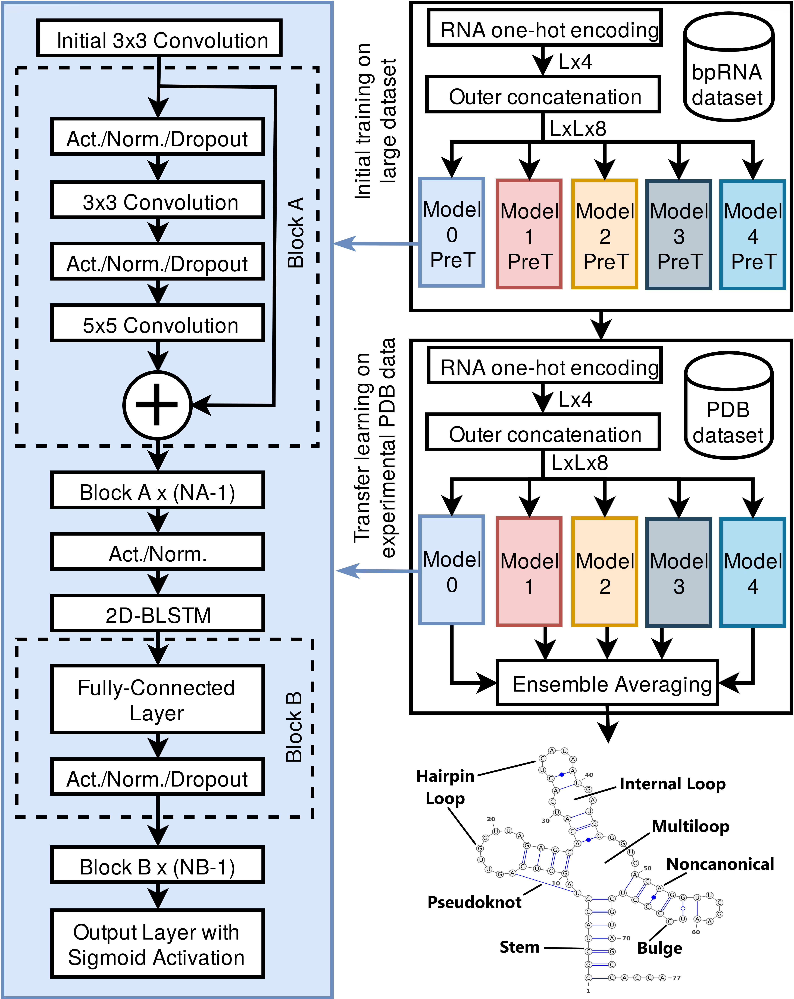
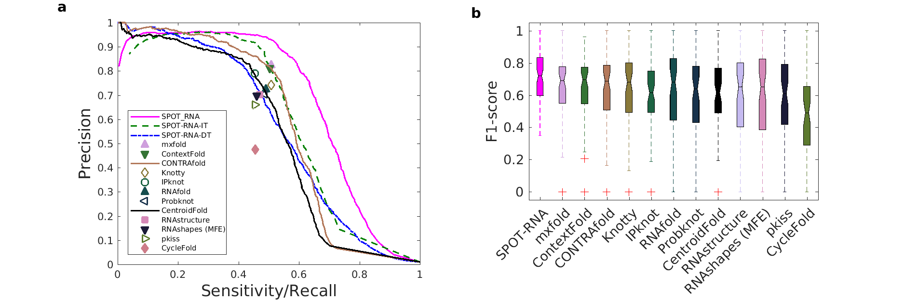

SPOT-RNA: *RNA Secondary Structure Prediction using an Ensemble of Two-dimensional Deep Neural Networks and Transfer Learning.*
====

Contents
----
  * [Introduction](#introduction)
  * [Results](#results)
  * [System Requirments](#system-requirments)
  * [Installation](#installation)
  * [Usage (Original TensorFlow Version)](#usage-original-tensorflow-version)
  * [PyTorch Version (SPOT-RNA-PyTorch)](#pytorch-version-spot-rna-pytorch)
  * [Datasets](#datasets)
  * [Citation guide](#citation-guide)
  * [Licence](#licence)
  * [Contact](#contact)

Introduction
----
The majority of our human genome transcribes into noncoding RNAs with unknown structures and functions. Obtaining functional clues for noncoding RNAs requires accurate base-pairing or secondary-structure prediction. However, the performance of such predictions by current folding-based algorithms has been stagnated for more than a decade. Here, we propose the use of deep contextual learning (Figure 1) for base-pair prediction including those noncanonical and non-nested (pseudoknot) base pairs stabilized by tertiary interactions. Since only less than 250 nonredundant, high-resolution RNA structures[2] are available for model training, we utilize transfer learning from a model initially trained with a recent high-quality bpRNA[1] dataset of >10,000 nonredundant RNAs made available through comparative analysis.

|
|----|
| <p align="center"> <b>Figure 1:</b> The network layout of the SPOT-RNA, where L is the sequence length of a target RNA, Act. indicates the activation function, Norm. indicates the normalization function, and PreT indicates the pretrained (initial trained) models trained on the bpRNA dataset.|

Results
----
The
resulting method (SPOT-RNA) achieves 94% precision at 50% sensitivity (Figure 2). Furthermore, it improves F1-score by a respective 53% and
60% over existing techniques in predicting noncanonical and non-nested base pairs. SPOT-RNA is also available as web-server at https://sparks-lab.org/server/spot-rna/. The web-server provides an arc diagram and a 2D diagram of predicted RNA secondary the structure through Visualization Applet for RNA (VARNA)[3] tool along with a dot plot of SPOT-RNA predicted base-pair probabilities.

|
|----|
| <p align="center"> <b>Figure 2:</b> Performance comparison of SPOT-RNA with 12 other predictors by using PR curve and boxplot on the test set TS1. **a** Precision-recall curves on the independent test set TS1 by initial training (SPOT-RNA-IT, the green dashed line), direct training (SPOT-RNA-DT, the blue dot-dashed line), and transfer learning (SPOT-RNA, the solid magenta line). Precision and sensitivity results from ten currently used predictors are also shown as labeled with open symbols for the methods accounting for pseudoknots and filled symbols for the methods not accounting for pseudoknots. CONTRAfold and CentroidFold were also shown as curves (Gold and Black) because their methods provide predicted probabilities. **b** Distribution of F1 score for individual RNAs on the independent test set TS1 given by various methods as labeled. On each box, the central mark indicates the median, and the bottom and top edges of the box indicate the 25th and 75th percentiles, respectively. The outliers are plotted individually by using the “+” symbol.|

System Requirments
----

**Hardware Requirments:**
SPOT-RNA predictor requires only a standard computer with around 16 GB RAM to support the in-memory operations for RNAs sequence length less than 500. (This applies to both TensorFlow and PyTorch versions).

**Software Requirments (Original TensorFlow Version):**
* [Python3](https://docs.python-guide.org/starting/install3/linux/)
* [virtualenv](https://virtualenv.pypa.io/en/latest/installation/) or [Anaconda](https://anaconda.org/anaconda/virtualenv)
* [CUDA 10.0](https://developer.nvidia.com/cuda-10.0-download-archive) (Optional If using GPU)
* [cuDNN (>= 7.4.1)](https://developer.nvidia.com/cudnn) (Optional If using GPU)

**Software Requirments (PyTorch Version):**
* [Python3](https://docs.python-guide.org/starting/install3/linux/) (Python 3.7+ recommended)
* [virtualenv](https://virtualenv.pypa.io/en/latest/installation/) or [Anaconda](https://anaconda.org/anaconda/virtualenv)
* PyTorch (CPU or GPU version, see https://pytorch.org/get-started/locally/)
* NumPy, Pandas (usually installed with PyTorch or via `requirements.txt`)
* CUDA/cuDNN (if using GPU version of PyTorch)

SPOT-RNA (both versions) has been tested on Ubuntu 14.04, 16.04, and 18.04 operating systems. The PyTorch version is generally more portable across different operating systems.

Installation
----

**For Original TensorFlow Version:**

1. `git clone https://github.com/jaswindersingh2/SPOT-RNA.git`
2. `cd SPOT-RNA`
3. `wget 'https://www.dropbox.com/s/dsrcf460nbjqpxa/SPOT-RNA-models.tar.gz' || wget -O SPOT-RNA-models.tar.gz 'https://app.nihaocloud.com/f/fbf3315a91d542c0bdc2/?dl=1'`
4. `tar -xvzf SPOT-RNA-models.tar.gz && rm SPOT-RNA-models.tar.gz` (This provides the TensorFlow models)

Either follow **virtualenv** column steps or **conda** column steps to create virtual environment and to install SPOT-RNA dependencies given in table below:<br />

|  | &nbsp;&nbsp;&nbsp;&nbsp;&nbsp;&nbsp;&nbsp;&nbsp;&nbsp;&nbsp;&nbsp;&nbsp;&nbsp;&nbsp;&nbsp;&nbsp;&nbsp;&nbsp;&nbsp;&nbsp;&nbsp; virtualenv | &nbsp;&nbsp;&nbsp;&nbsp;&nbsp;&nbsp;&nbsp;&nbsp;&nbsp;&nbsp;&nbsp;&nbsp;&nbsp;&nbsp;&nbsp;&nbsp;&nbsp;&nbsp;&nbsp;&nbsp;&nbsp;&nbsp;&nbsp;&nbsp;&nbsp;&nbsp;&nbsp;&nbsp;&nbsp;&nbsp;&nbsp;&nbsp;&nbsp;&nbsp;&nbsp;&nbsp; conda |
| :- | :-------- | :--- |
| 5. | `virtualenv -p python3.6 venv_tf` (using python3.6 for TF 1.14) | `conda create -n venv_tf python=3.6` |
| 6. | `source ./venv_tf/bin/activate` | `conda activate venv_tf` | 
| 7. | *To run SPOT-RNA on CPU:*<br /> <br /> `pip install tensorflow==1.14.0` <br /> <br /> &nbsp;&nbsp;&nbsp;&nbsp;&nbsp;&nbsp;&nbsp;&nbsp;&nbsp;&nbsp;&nbsp;&nbsp;&nbsp;&nbsp;&nbsp;&nbsp;&nbsp;&nbsp;&nbsp;&nbsp;&nbsp;&nbsp;&nbsp;&nbsp; *or* <br /> <br />*To run SPOT-RNA on GPU:*<br /> <br /> `pip install tensorflow-gpu==1.14.0` | *To run SPOT-RNA on CPU:*<br /> <br /> `conda install tensorflow==1.14.0` <br /> <br /> &nbsp;&nbsp;&nbsp;&nbsp;&nbsp;&nbsp;&nbsp;&nbsp;&nbsp;&nbsp;&nbsp;&nbsp;&nbsp;&nbsp;&nbsp;&nbsp;&nbsp;&nbsp;&nbsp;&nbsp;&nbsp;&nbsp;&nbsp;&nbsp; *or* <br /> <br />*To run SPOT-RNA on GPU:*<br /> <br /> `conda install tensorflow-gpu==1.14.0` |
| 8. | `pip install -r requirements_tf.txt` (assuming original requirements are renamed) | `while read p; do conda install --yes $p; done < requirements_tf.txt` | 

**For PyTorch Version (SPOT-RNA-PyTorch):**

(Assumes you have already cloned the repository: `git clone https://github.com/jaswindersingh2/SPOT-RNA.git && cd SPOT-RNA`)

1. Create a new virtual environment (Python 3.7+ recommended):
   * Using virtualenv:
     ```bash
     virtualenv -p python3 venv_pytorch
     source ./venv_pytorch/bin/activate
     ```
   * Using conda:
     ```bash
     conda create -n venv_pytorch python=3.8  # Or any Python 3.7+
     conda activate venv_pytorch
     ```
2. Install PyTorch:
   Visit https://pytorch.org/get-started/locally/ to get the correct command for your system (OS, package manager, CUDA version if applicable). For example:
   ```bash
   # Example for Linux, pip, with CUDA 11.8 (check PyTorch website for current commands)
   # pip install torch torchvision torchaudio --index-url https://download.pytorch.org/whl/cu118
   # Example for CPU only:
   pip install torch torchvision torchaudio
   ```
3. Install other dependencies:
   The PyTorch version uses a `requirements.txt` file (which should have been updated on the `pytorch-conversion` branch).
   ```bash
   pip install -r requirements.txt 
   ```
   This will install `numpy`, `pandas`, etc. (Note: `argparse` is part of standard Python).

Usage (Original TensorFlow Version)
----

**For single sequence:**
```
python3 SPOT-RNA.py  --inputs sample_inputs/single_seq.fasta  --outputs 'outputs/'  --cpu 32
```
The output come of above command will be three files (.bpseq, .ct, and .prob) in 'outputs' folder. The '.bpseq' and '.ct' file is the standard format to represent RNA secondary structure. '.prob' file consists of the base-pair probability of predicted secondary structure by SPOT-RNA which can be useful for plotting PR-curve and to check the confidence of predicted base-pair.

**For batch of sequences:**
```
python3 SPOT-RNA.py  --inputs sample_inputs/batch_seq.fasta  --outputs 'outputs/'
```

**To run on GPU:**

SPOT-RNA can be run on GPU by setting '--GPU' argument to GPU's number in the system. Specify '0' if only a single GPU is available. Running SPOT-RNA on GPU reduces the computation time of prediction by almost 15 times.
```
python3 SPOT-RNA.py  --inputs sample_inputs/batch_seq.fasta  --outputs 'outputs/' --gpu 0
```

**2D plots of predicted secondary structure (VARNA):**
(Requires Java, see [System Requirments](#system-requirments) and original installation for Java setup)
```
python3 SPOT-RNA.py  --inputs sample_inputs/single_seq.fasta  --outputs 'outputs/' --plots True
```

**Secondary structure motifs from predicted structure (bpRNA):**
(Requires Perl and Graph.pm module, see original installation for setup)
```
python3 SPOT-RNA.py  --inputs sample_inputs/single_seq.fasta  --outputs 'outputs/' --plots True --motifs True
```

PyTorch Version (SPOT-RNA-PyTorch)
----
This section describes the PyTorch version of SPOT-RNA, named `SPOT-RNA_pytorch.py`. It is a conversion of the data processing and inference pipeline from TensorFlow to PyTorch.

**Important Note on Pre-trained Models:**
The original pre-trained TensorFlow models (`.meta`, `.index`, `.data` files) are **not automatically converted** to PyTorch format by this script. The `SPOT-RNA_pytorch.py` script currently includes a `PlaceholderSPOTRNA` model. To perform actual predictions with the same accuracy as the original SPOT-RNA, equivalent pre-trained PyTorch models (e.g., `.pth` or `.pt` files for the ensemble) would need to be trained or converted separately and loaded into the PyTorch model class. The script contains commented-out placeholders where `model.load_state_dict(...)` would be called.

**Basic Usage:**
The command-line arguments are similar to the original TensorFlow version.

*   **For a single sequence:**
    ```bash
    python SPOT-RNA_pytorch.py --inputs sample_inputs/single_seq.fasta --outputs outputs_pytorch/ --cpu 4
    ```
*   **For a batch of sequences:**
    ```bash
    python SPOT-RNA_pytorch.py --inputs sample_inputs/batch_seq.fasta --outputs outputs_pytorch/
    ```
*   **To run on GPU (if PyTorch GPU version is installed and models are adapted for GPU):**
    ```bash
    python SPOT-RNA_pytorch.py --inputs sample_inputs/batch_seq.fasta --outputs outputs_pytorch/ --gpu 0
    ```
    (Note: The current placeholder model runs on CPU by default, but device handling is included for future models).

*   **To generate 2D plots (requires Java and VARNA setup, see original TensorFlow section for details):**
    ```bash
    python SPOT-RNA_pytorch.py --inputs sample_inputs/single_seq.fasta --outputs outputs_pytorch/ --plots True
    ```
*   **To generate motifs (requires Perl and bpRNA setup, see original TensorFlow section for details):**
    ```bash
    python SPOT-RNA_pytorch.py --inputs sample_inputs/single_seq.fasta --outputs outputs_pytorch/ --motifs True --plots True 
    ```

**Output Files:**
The PyTorch version produces the same output files as the original:
*   `.ct` file: Connectivity table representing the secondary structure.
*   `.bpseq` file: Base pair sequence format.
*   `.prob` file: Contains the (L,L) probability map for base pairings.
*   Optional: `.png` files for VARNA plots if `--plots True`.
*   Optional: `.st` and `.dbn` files if `--motifs True`.

**Requirements File:**
The PyTorch version uses an updated `requirements.txt` file which includes `torch` and other necessary Python packages. Ensure you have installed these using `pip install -r requirements.txt` in your PyTorch environment.

Datasets
----

The following datasets were used for Initial Training:
* bpRNA[1]: Initial Learning (Training TR0, validation VL0, and test TS0)  
[Dropbox](https://www.dropbox.com/s/w3kc4iro8ztbf3m/bpRNA_dataset.zip) or [Nihao Cloud](https://app.nihaocloud.com/d/26df85ca06bc4eae8f6f/)


The following datasets were used for Transfer Learning:
* PDB[2]: Transfer Learning (Training TR1, validation VL1, and test TS1)  
[Dropbox](https://www.dropbox.com/s/vnq0k9dg7vynu3q/PDB_dataset.zip?dl=0) or [Nihao Cloud](https://app.nihaocloud.com/f/d61638e03bc5484f8f83/)

Citation guide
----

**If you use SPOT-RNA for your research please cite the following papers:**

Singh, J., Hanson, J., Paliwal, K., Zhou, Y. RNA secondary structure prediction using an ensemble of two-dimensional deep neural networks and transfer learning. Nat Commun 10, 5407 (2019) https://doi.org/10.1038/s41467-019-13395-9

**If you use SPOT-RNA data sets and/or post-processing (2D plots, structural motifs from SPOT-RNA output) pipeline, please consider citing the following papers:**

[1] Padideh Danaee, Mason Rouches, Michelle Wiley, Dezhong Deng, Liang Huang, David Hendrix, bpRNA: large-scale automated annotation and analysis of RNA secondary structure, Nucleic Acids Research, Volume 46, Issue 11, 20 June 2018, Pages 5381–5394, https://doi.org/10.1093/nar/gky285

[2] H.M. Berman, J. Westbrook, Z. Feng, G. Gilliland, T.N. Bhat, H. Weissig, I.N. Shindyalov, P.E. Bourne. (2000) The Protein Data Bank Nucleic Acids Research, 28: 235-242.

[3]  VARNA: Interactive drawing and editing of the RNA secondary structure Kévin Darty, Alain Denise and Yann Ponty Bioinformatics, pp. 1974-1975, Vol. 25, no. 15, 2009 

Licence
----
Mozilla Public License 2.0


Contact
----
jaswinder.singh3@griffithuni.edu.au, yaoqi.zhou@griffith.edu.au
